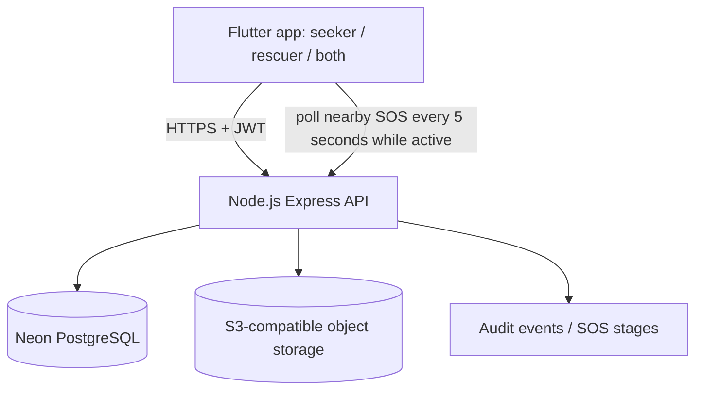

# RESQ-MITRA Technical Design

## Architecture

## Trust boundaries
- The Flutter APK contains only the public API base URL; it must never contain `DATABASE_URL`, `JWT_SECRET`, or object-storage secret keys.
- The API authenticates protected endpoints using a signed JWT and checks ownership for private identity documents.
- Files are stored in S3-compatible object storage when all `S3_*` settings are present; otherwise the API falls back to PostgreSQL `bytea` storage for backward compatibility.
- The API returns files through an authenticated endpoint, rather than exposing public object URLs.

## Core data flow
1. Registration creates a user, contacts and JWT.
2. A seeker posts an SOS; the API persists the request and its events.
3. Active responders poll the nearby-SOS endpoint while online; acceptance is assigned atomically by the API.
4. Responders update stages; seeker clients refresh the SOS state.
5. Photos, voice notes and profile documents are uploaded to `/files`; the API stores object keys in the database and enforces ID-document ownership on reads.

## Production limitations / launch gates
- This package alone does not prove production readiness or guarantee emergency delivery. The current polling model requires the app to be running; background/closed-app alerts require a properly configured push provider and real-device tests.
- Add real phone/email verification, administrator review of responder identity, monitoring/alerting, backups, retention/deletion workflows, encryption/key rotation and abuse response before public emergency use.
- Run load tests and end-to-end tests on real Android devices and unreliable networks. Do not advertise an emergency service as guaranteed until independently validated.
